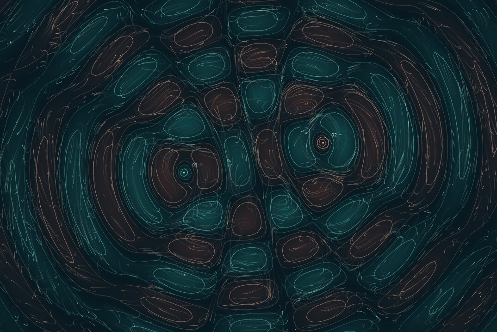

# Ripple: Resonance

## Development stage 1 — reliable source controls

This version adds keyboard source creation, an explicit source selector and a
fix for multi-touch drag ownership. See [the revision guide](docs/REVISION_GUIDE.zh-CN.md)
and `docs/revisions/01-*` for the changes and actual automated test results.

An original interactive artwork made with **p5.js 1.11.11**.

Separate actions form a shared pattern. Place a wave source, move it, and change
its phase. Each change reshapes the combined field and the paths of the particles.
This develops the earlier *Ripple* proposal after tutor feedback that the first
mechanic was too simple.

## Run the work

1. Extract the whole project folder.
2. Open `index.html` in a modern desktop browser.
3. Keep the `js` and `vendor` folders in the same folder as `index.html`.

The p5.js library is included locally. The artwork needs no internet connection,
build step, npm installation, audio file or microphone. Direct opening from a
local file was checked in Chrome Headless Shell with external requests blocked.
A desktop computer is best for a presentation. The layout also adjusts to a phone.

If your browser has a local-file restriction, use VS Code Live Server, or run
`python3 -m http.server 8000` in the project folder and open `http://localhost:8000`.

## Inspiration and artistic aim

The starting image is a drop on water. The first proposal represented this with
separate circles. The new work asks how one action changes the conditions around
another action. Its sources share one calculated field, so their relationship
matters. Moving a source can change patterns far from the pointer.

Edmonds (2010) discusses audience participation as part of interactive art. This
supports the decision to let visitors change the work's structure. Shneiderman
(1983) supports visible responses to direct actions. Source guides, immediate
updates and a pause control make these changes easier to see.

The work also draws on wave superposition, explained by Feynman et al. (n.d.),
and flow fields described by Shiffman (2024). These ideas shape an original visual
interpretation. This is **an artistic wave field**, not a full water simulation or
a scientific model of human behaviour. The first version has one user at a time.

## Interaction instructions

| Action | Result |
| --- | --- |
| Click an empty part of the canvas | Add a persistent wave source, up to six sources |
| Click and drag a source | Move it and reshape the whole field |
| Reverse phase button, or `P` | Switch the selected source between phase 0 and phase pi |
| Source strength slider | Change the selected source's contribution |
| Wave spacing slider | Change the distance between wave bands for all sources |
| Natural drift slider | Change the contribution of smooth Perlin flow to particle motion |
| Pause button, or Space | Freeze time while keeping source editing available |
| Remove button, or Delete | Remove the selected source |
| Restore scene, or `R` | Restore the two starting sources, time, spacing, drift and seed |
| New drift, or `N` | Change the seed and restart particle traces |
| Save image, or `S` | Download the actual p5.js canvas as a PNG |
| `G` | Hide or show the numbered source guides |
| Focus canvas, then arrow keys | Move the selected source. Hold Shift for a larger step |

Shortcuts do not run while a slider, button or other form control has focus.
Click the canvas to return to canvas keyboard controls. Shift-click on empty
space creates a source with the opposite phase. Touch and pen use the same
Pointer Events pathway as the mouse. Multi-touch editing is not supported.

Try moving the two starting sources closer together. Reverse one phase and
compare the bands. Pause time if the changing picture is difficult to follow.
Teal and coral show the **sign of the combined wave value**. They are not fixed
colours assigned to particular participants. A plus/minus label shows source phase.

## What changed after the concept presentation

| Earlier proposal | Implemented development | Why the change matters |
| --- | --- | --- |
| A press made one circle larger | Sources persist and can be moved | Visitors can keep changing a composition |
| Circles overlapped as separate drawings | Source values add into one field | One source changes the pattern formed with other sources |
| One action mainly changed size | Phase and strength change reinforcement and cancellation | Visitors can explore a relationship, not just one visual property |
| Simple fading | Particles follow the evolving field and leave short trails | Earlier movement remains visible for a limited time |
| A static concept illustration | A working local p5.js prototype | Behaviour can be tested and demonstrated directly |

## Mechanic ownership

**Owner: Mario. The primary chosen mechanic is **user input**. Pointer
manipulation, phase changes and parameter controls form one connected way of
shaping the shared field. The input mechanic lives in `js/input-controls.js`.

Perlin noise and seeded randomness provide a supporting generative layer in
`js/perlin-flow.js`. Animation time supports field updates in `sketch.js`.
These features are documented separately so their roles remain clear. Confirm
that this individual scope matches the tutor's arrangement for solo work.

## Code structure and communication

| File | Main class or function | Responsibility |
| --- | --- | --- |
| `sketch.js` | p5 instance, `setup`, `draw` | Coordinate modules, simulation time, pause and resizing |
| `js/input-controls.js` | `InputController` | Select, add, drag and remove wave sources |
| `js/wave-field.js` | `WaveSource`, `WaveField`, `contourSegments` | Calculate superposition, sample a bounded grid and draw its contours |
| `js/perlin-flow.js` | `PerlinFlow` | Produce smooth seeded directions and set the random seed |
| `js/particle-system.js` | `TraceParticle`, `ParticleSystem` | Move particles using the field and drift; draw short memory trails |
| `js/ui.js` | `ArtworkUI` | Connect buttons, sliders and keyboard input to the shared state |
| `style.css` | CSS rules | Arrange the canvas and controls across screen sizes |
| `vendor/p5.min.js` | Unmodified external library | Supply the p5.js runtime |

The input controller changes `WaveSource` objects held by `WaveField`. The next
frame samples the updated sources. The particle system reads that same grid, so
the picture and particle paths respond to the same change. The UI reads the
selection and values, rather than keeping a second copy of the source data.

Instance-level state includes `field`, `flow`, `particles`, `sceneTime`, `paused`
and `controls`. These stay inside the p5 instance, rather than becoming window
globals. Each `WaveSource` stores its own position, amplitude and phase. Each
particle stores its own position, velocity and lifetime. Temporary values such
as distance, interpolation weights and frame time remain local to functions.

## Techniques and why they are used

### 1. Radial waves and superposition

Each source contributes:

`amplitude * exp(-decay * distance) * sin(2*pi*distance/spacing - speed*time + phase)`

The contributions add into one scalar value at each sampled point. Equal,
opposite sources at exactly the same position cancel in this mathematical field.
The fade with distance keeps distant bands less dominant. Distances use the
shorter canvas dimension as a common unit, keeping circles proportionate.
This formula is an artistic simplification inspired by wave superposition.

### 2. Contours with marching squares

The field is sampled on a two-dimensional grid. Each small cell has four corner
values. The contour function finds where a chosen level crosses an edge, uses
linear interpolation to locate that crossing, and joins the crossings. This is
the marching-squares idea described in the scikit-image documentation. Its Python
code is not included or copied. The JavaScript implementation is specific to this
project. In an ambiguous saddle cell, the average corner value decides the
connection. This is a visual rule, not a claim of an exact topology solver.

### 3. Wave-responsive particles and Perlin drift

Central differences estimate how the field changes around a particle. Rotating
this gradient by 90 degrees gives a direction along the contour. Smooth noise
adds a smaller changing direction. A particle eases toward the combined velocity
and has a capped speed. An offscreen p5 graphics buffer stores its trail. The
buffer gradually loses alpha, so old paths fade without storing every past point.

`noiseSeed()` controls Perlin noise. `randomSeed()` controls the random initial
particle positions, lifetimes and stroke weights. These are separate uses of
noise and randomness. Restoring the same seed restores the starting configuration,
but exact later frames can vary with frame timing and browser performance.

### 4. Direct input and responsive design

Pointer capture continues a drag when the pointer leaves the canvas. Releasing,
cancelling, changing tabs or losing focus ends the drag. Source positions are
normalised to the canvas size. On resize, the field and particle buffer rebuild,
while relative source positions stay the same. Old trail pixels clear on resize.
Users with a reduced-motion preference start with time paused.

## Efficiency decisions

- At most six sources. Additional clicks at the limit show an instruction.
- At most 1,500 particles. The count scales down on smaller canvases.
- Grid dimensions are bounded at 150 by 110 cells.
- The grid is calculated once per frame and reused by particles and contours.
- Contour segments use one canvas path per level, rather than a draw call per segment.
- Pixel density is fixed at one, avoiding extra work on high-density screens.
- Movement uses elapsed time with a capped step, avoiding a large jump after a stall.
- A paused scene redraws only when the user changes something.

The sources and particle limits are design choices. They are not proven optimal.
No microphone, audio analysis, WebGL shader or external visual asset is needed.

## AI acknowledgement

OpenAI ChatGPT/Codex assisted with the concept upgrade, JavaScript, HTML/CSS,
code explanations, documentation and automated tests. The generated code
implements the wave field, contours, particle motion, input handling and UI.

## Testing and development history

- Six Node tests check cancellation, phase reversal, source bounds, contour
  crossings, saddle cells and resize interpolation.
- Automated browser checks cover offline opening, controls, pointer release,
  source limits, pause, PNG export, viewport resizing and reduced motion.
- See `docs/TESTING.md` and `docs/browser-report.json` for the recorded results.
- Tests use Node/Playwright only during development. They are not required to run
  the artwork.

Run the mathematical tests with `node --test tests/field.test.cjs`.
The browser test needs Playwright and a compatible local Chrome executable;
instructions appear at the start of `tests/browser.cjs`.

## External references in APA 7th format

Edmonds, E. (2010). The art of interaction. *Digital Creativity, 21*(4), 257–264. https://doi.org/10.1080/14626268.2010.556347

Feynman, R. P., Leighton, R. B., & Sands, M. (n.d.). Interference. In *The Feynman lectures on physics* (Vol. I, Chapter 29). California Institute of Technology. https://www.feynmanlectures.caltech.edu/I_29.html

MDN contributors. (2025, October 1). *Element: setPointerCapture() method*. MDN Web Docs. https://developer.mozilla.org/en-US/docs/Web/API/Element/setPointerCapture

p5.js. (n.d.). *Reference*. Retrieved October 16, 2026, from https://p5js.org/reference/

scikit-image developers. (n.d.). *skimage.measure.find_contours*. In *scikit-image documentation*. Retrieved October 16, 2026, from https://scikit-image.org/docs/stable/api/skimage.measure.html#skimage.measure.find_contours

Shiffman, D. (2024). *The nature of code*. No Starch Press. https://natureofcode.com/autonomous-agents/

Shneiderman, B. (1983). Direct manipulation: A step beyond programming languages. *Computer, 16*(8), 57–69. https://doi.org/10.1109/MC.1983.1654471

Specific p5.js API links also appear in code comments. The local p5.js file came
from https://cdnjs.cloudflare.com/ajax/libs/p5.js/1.11.11/p5.min.js and retains its
original version header. Its licence is included in `vendor/LICENSE-p5.txt`.
The project does not copy an existing artwork or use the earlier AI concept image
as its rendered output.
